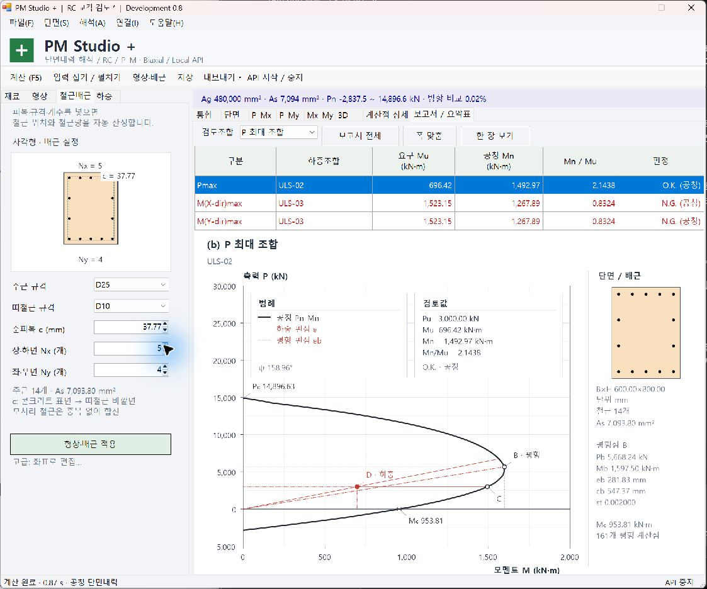

# PM Studio + 0.8

RC 단면 P–M 상관도 해석 프로그램의 개발 소스 저장소입니다. 계산 DLL, Windows UI, 로컬 API, 예제와 검증 코드를 함께 관리합니다.

## 다른 PC에서 시작

```powershell
git clone https://github.com/sjidok750-creator/UMD.git
cd UMD
powershell -NoProfile -ExecutionPolicy Bypass -File .\build.ps1
.\PMStudio.exe
```

Windows 10/11 및 .NET Framework 4.x C# 컴파일러를 사용합니다. 전체 재검증에는 Python 3도 필요합니다. `verify-all.ps1`로 빌드와 C#/Python 검증을 실행하며 출력은 `artifacts/`에 생성됩니다. 개발 구조, 동기화와 환경 설정은 [DEVELOPMENT.md](DEVELOPMENT.md)를 확인하세요. GitHub Actions의 Windows 빌드·검증도 포함합니다.



Windows RC 단면내력 개발판. 고딕 글꼴, 고전 Windows UI, 독립 계산 DLL 및 로컬 API.

## 실행

ZIP을 한 폴더에 모두 풀고 PMStudio.exe를 실행합니다. PMStudio.Core.dll을 같은 폴더에 둡니다. 이 PC의 Windows .NET Framework에서 빌드했습니다.

- 시작 화면에서 예제를 열거나, 단면 메뉴에서 가상 교각 / 공개 검증예제를 선택합니다.
- 형상 탭에서 그림의 B/H/D/내경 치수를 입력하고, 철근배근 탭에서 규격·피복·개수를 입력합니다. 좌표 편집은 고급 메뉴로 옮겼습니다. GUIDED-INPUT.md를 참고하세요.
- 입력 후 F5로 계산합니다. 기본 결과 탭은 **보고서 / 요약표**이며, 선택 조합의 상세 그래프를 표시합니다.
- 검토조합 목록이나 표 행으로 상세 곡선을 바꿉니다. 보고서 전체 / 폭 맞춤 / 한 장 보기는 출력물 확인용입니다. 그래프 클릭 시 공칭 단면 상태를 상세 탭에서 확인합니다.
- 보고서용 상관도: 왼쪽 그래프 + 오른쪽 단면·배근, PNG 3000×1950 px / 300 dpi 또는 벡터 EMF. 전체 요약시트 PNG: 2400×2700 px. 요약표 PNG: 2400×740 px.
- 해석 메뉴에서 보고서 그림, 요약표 PNG/CSV, 전체 곡선 CSV, HTML을 저장합니다.
- 통합 결과 탭은 양쪽 방향 곡선, 단면·변형률 및 회전 가능한 3D 상관면을 유지합니다.

## 이번 그래프의 의미

한쪽 상관도는 특정 모멘트 방향 ψ에 대한 3D 상관면의 세로 절단입니다. 반대 방향은 ψ+180°로 따로 계산합니다. 비대칭 단면의 음 방향 내력을 양 방향 내력의 거울상으로 만들지 않습니다. 인장 축력도 포함하므로 엄밀히 1사분면만인 도표는 아닙니다.

검정 곡선은 공칭내력 Pn–Mn입니다. 파랑 곡선은 **명시적으로 선택한 계수 비교 모드에서만** 표시합니다. 파랑 곡선의 각 점에는 같은 상태의 Pn와 Mn 양쪽에 φ를 적용합니다. 특정 검토 축력 Pu에서의 파랑 내력점은 φPn=Pu를 다시 만족하도록 찾으며, Pn=Pu에서 계산한 Mn에 φ만 곱하지 않습니다. φ의 구간 변화나 단면 형상에 따른 꺾임을 임의 스플라인으로 펴지 않습니다.

빨간 실선은 하중점 D 방향의 일정 편심 e=M/P 선입니다. 빨간 점선은 공칭 균형점 B로 향하는 편심선 eb=Mb/Pb입니다. 같은 축력의 수평선으로 D와 내력점 Cn/Cr을 비교합니다. 세로 점선은 하중 모멘트 읽기 보조선입니다. 이 선들을 추가적인 내력곡선으로 해석하지 않습니다. M=√(Mx²+My²), P 압축 양수, e(mm)=1000×M(kN·m)/P(kN). P=0이면 편심을 유한값으로 표시하지 않습니다.

P최대 / |Mx|최대 / |My|최대가 발생한 **원래 조합의 P·Mx·My 동시 발생값**으로 3개 그래프와 표를 생성합니다. ψ=atan2(My,Mx)와 중립축 선의 각도 αNA는 별도로 계산합니다. 각 축력에서 방향 평형을 풀며, 균형점·순수휨점·철근 변형률 제어점을 포함하여 중점 현 오차 기준으로 적응 세분화합니다. 현 오차는 그림 품질 지표이며 전역 수치오차 보증이 아닙니다.

## 평가 범위와 계수 모드

기본 `ReductionProfile=Nominal`은 일반 RC 공칭 모델입니다. 사용자가 지정한 αFc 직사각형 블록, βc 깊이, εcu, 탄성완전소성 철근을 사용합니다. Fc 수정 시 α·β·εcu를 자동으로 기준 보정하지 않습니다.

`Reference-ACI31819-Tied`는 공개 예제 검산을 위한 **참고 계수 비교**입니다. ACI 318-19 띠철근 φ=0.65~0.90, 인장변형률 εy~εy+0.003, 축력상한 0.80×0.65×P0를 사용합니다. εcu·α·β 입력의 호환성을 검사합니다. KDS 적용 모드나 부재 전체 설계 적합 판정으로 제공하지 않습니다. 공개 검증예제는 이 모드를 명시적으로 선택하여 별도 프로젝트로 저장했습니다. 기존 프로젝트와 일반 예제의 기준은 임의로 바꾸지 않습니다.

`BarDisplacement=ExactDisk`(기본)는 블록 내 철근 원의 면적·일차모멘트를 적분하여 콘크리트 중복을 공제합니다. `CenterLumped`는 공개 손계산 예제와 맞추기 위해 철근 중심 기준으로 전면적을 공제하는 비교 모델입니다. 두 모델이 블록 경계에서 다른 값을 낼 수 있음을 검증 로그에 기록했습니다.

표는 Nominal 모드에서 Mn 및 Mn/Mu, 참고 모드에서 φMn 및 φMn/Mu를 보여 줍니다. 기존 하중표의 요구/내력 사용률과 역수입니다. 영모멘트 비율은 미정의입니다. 방향 N/2N 비교에서 상대 변화가 1% 초과하거나 판정이 바뀌는 경우, 세분화 한계 및 계수곡선의 복수 교점은 미확정으로 처리합니다. 복수 교점에서는 최소 모멘트 교점을 참고 표시하며 자동 O.K.를 내지 않습니다.

전단·비틀림, 장주·P–Δ, 구속콘크리트, 좌굴·파단, 최소편심·철근비·배근상세의 기준별 검토, PSC/강재/합성은 미구현입니다. 입력 허용 범위는 설계기준의 허용 범위를 뜻하지 않습니다.

## 입력 및 API

단위 mm, mm², MPa, kN, kN·m. 모멘트 기준점은 개구부를 뺀 콘크리트 형상의 기하도심입니다. Mx=∫σ(y−yc), My=−∫σ(x−xc). 다른 프로그램에서 가져올 때 국부축·부호·기준점을 맞춰야 합니다.

다각형 외곽 1개, 개구부 8개, 철근 300개, 하중조합 40개를 지원합니다. 일반 원형의 다각형 입력과 원형 적분 R>0의 해석적 원형 모델을 구분합니다. 동일 콘크리트와 철근 재료의 RC 모델만 계산합니다.

로컬 API는 PMStudio.Api.exe 또는 화면의 API 시작/중지로 실행합니다. 기본 주소 http://127.0.0.1:18741 . 자세한 호출법은 API.md 및 api-example.py를 보세요. JSON 결과의 ReportDiagrams에 방향별 원본 계산점·균형점·내력점·선택한 참고 계수 결과가 포함됩니다.

## 검증

verification.txt: 기존 검사 762개와 새 그림 입력 검사 46개, C# 총 808개가 통과했습니다. 별도 Python 기존 독립 검사 22개와 수직 구간 적분 544상태 / 2,176수치 비교도 다시 실행했습니다. 검사 수가 기준 인증이나 지원 단면 수를 뜻하지 않습니다.

공개 StructurePoint Grade 60 및 Grade 80 예제의 순압축, 축력상한, 순인장, 철근 응력 0 / 0.5fy / fy, 인장지배 한계, 순수휨을 원문 표의 spColumn 값과 대조했습니다. 표의 반올림 정밀도를 기준으로 허용오차를 정했으며, 상용 프로그램을 직접 실행한 비교는 아닙니다. 자세한 출처와 한계는 GRAPH-MEANING.md를 보세요.

이번 버전은 실제 Windows 창에서 형상·철근배근 화면과 글자 배치, Nx 변경 후 개수·As 갱신 및 F5 해석 반영을 확인했습니다. 구성요소·그래픽·내보내기도 자동 검사했습니다. 모든 메뉴와 저장 대화상자의 전체 경로를 실행한 것은 아닙니다.

## 빌드와 재검증

build.ps1 / verify.ps1을 PowerShell로 실행합니다. Windows .NET Framework C# 컴파일러를 사용하며 외부 패키지 설치가 필요하지 않습니다. 계산엔진: Model/Geometry/SectionSolver/Engine/DirectionalSolver/Reduction. UI: App/Plots/Dashboard/ReportSheet/Theme. 출력: Reports. API: ApiServer/ApiMain. 소스와 검사 코드를 함께 제공합니다.

## 0.4 고정 화면과 편람 검산
클라이언트 1120×910 DIP의 고정 창입니다. 입력 폭 300 DIP, 줄인 탭 이름과 내보내기 메뉴, 글꼴 실측 머리글/행 높이, 기본 상세 그래프를 사용합니다. 보고서 전체의 축소 이미지는 요청할 때 생성하여 재사용합니다. 출력 PNG 해상도는 화면 배율과 독립입니다.

단면 메뉴에서 ‘도로설계편람 2008 원형 교각’을 선택합니다. Reference-KR2008-Tied는 특정 편람 예제의 계수 검산 모드입니다. 현재 KDS를 대신하지 않습니다. 원형 적분 R>0은 개구부 없는 등분 원형 윤곽을 검사하고, 압축영역을 원호로 적분합니다. R=0이면 기존 다각형 모델입니다.

**편람 예제 전체는 미일치입니다.** 면적/철근량/최대 설계축력은 일치하지만 평형편심 5.87% 차이와 원문 표 내부 불일치가 남아 있습니다. MANUAL-2008-VALIDATION.md 및 examples/manual-2008-comparison.csv를 확인하세요. 이 모드에서는 자동 O.K. 대신 편람 대조 미확정을 표시합니다.


## 0.5 전문 도표와 재검증
선 종류가 표시된 범례, 주/보조 격자, 축력상한·평형점·순수휨점·하중/내력점, 곡선과 글자의 겹침을 피하는 표시를 적용했습니다. 내보내기 메뉴에서 선택 상관도를 PNG(3000×1950,300 DPI) 또는 벡터 EMF로 저장할 수 있습니다. EMF의 문자·선 레코드와 래스터 이미지 미포함을 검사했습니다.

새 공개 원형 8철근 예제와 직사각형 이축휨 예제는 단면 메뉴에 있습니다. 원형 예제의 주요 제어점은 공개 표의 반올림 정밀도에서 일치했고, 이축휨은 독립 적분 및 연립방정식으로 검증했습니다. VALIDATION-0.5.md에 실제 수치·비교 허용범위·출처·남은 한계를 적었습니다.

표준단면은 국내 D10~D38의 공칭 단면적을 사용합니다. **D25는 506.7 mm²이며 π×25²/4로 산정하지 않습니다.** 직접 면적 입력과 기존 프로젝트·API의 면적은 보존합니다. 기존 생성기에서 D25를 뜻하며 25 mm를 넣었던 행은 490.873852 mm²일 수 있습니다. 철근 탭의 해당 행에서 우클릭하여 D25 면적을 적용한 뒤 재계산하세요. 단면적을 조용히 자동 변경하지 않습니다. 기본 국내 예제의 철근 면적도 공칭면적으로 바뀌어 0.4의 계산값과 달라질 수 있습니다.

편람 예제는 이전에도 95×506.7=48,136.5 mm²를 사용했으므로 면적 오류가 평형편심 차이의 원인은 아닙니다. 실제 최외단 철근 기준 d=1900 mm와 원문 평균깊이1852.632 mm는 다른 조건입니다. 원문545.084 mm를 현재 배근에서 역산한 상태는 최외단 항복변형률을 만족하지 않음을 확인했습니다. 평균깊이 영향과 남은 원문 알고리즘 불확실성을 분리하여 VALIDATION-0.5.md에 기록했습니다.

독립 검사 재현: verify.ps1 실행 후 출력된 Test artifacts 폴더의 independent-states.json을 independent_check.py에 입력합니다. 사용법: python independent_check.py <independent-states.json> <comparison.csv>. Python 표준 라이브러리만 사용합니다.


## 0.6 그래프 내부 범례와 보고서 배치

범례와 핵심 검토값을 그래프 내부 상단의 두 정보 상자로 옮겼습니다. 상자 안쪽 여백을 확보하고, 곡선 위에 상자가 놓이지 않도록 축력 표시 범위에 공간을 추가합니다. 작용 Pu·Mu, 선택 모드의 Mn 또는 φMn, 내력/요구 비와 판정만 핵심값으로 표시합니다. 곡선에는 D 하중점, B 평형점, Cn/Cr 내력점, 순수휨 및 축력 절편을 표시하며, 글자끼리 또는 곡선 선분과 겹치는 위치를 피합니다. 전체 계산 상태는 기존 상세 탭·CSV에서 확인합니다.

오른쪽 단면·배근 그림과 평형점 상세값 배치는 유지했습니다. 해석 메뉴의 ‘보고서용 상관도 PNG’ 또는 ‘보고서용 상관도 EMF (벡터)’로 내보냅니다. examples/report-figure-Pmax, Mxmax, Mymax 파일이 같은 형식의 출력 예시입니다. 전체 요약시트도 별도로 저장할 수 있습니다.

6개 예제 × 3개 검토조합 × 2개 크기(810×520 / 1000×650 DIP) × 2개 배율(96 / 192 DPI)의 72개 상세 도표와 전체 시트·계산 데이터 유지 12개 항목을 검사합니다. 문자 실측 경계, 상자 여백, 문자 간 겹침, 곡선 선분과 문자·상자 충돌을 점검합니다. 축 범위와 배치 변경은 표시용이며, 계산 관련 소스 9개 파일은 0.5와 동일합니다. 이번 변경의 오프스크린 미리보기는 examples/inset-*-preview.png입니다.


## 0.7 추가 검증과 오른쪽 정렬

오른쪽 단면·배근 제목과 내용을 왼쪽 축력 제목 행에 맞춰 아래로 옮겼습니다. 왼쪽 그래프 배치는 유지했습니다.

단면 메뉴에 ACI E702.2 사각 기둥(공칭), 비대칭 벽체(공칭), 편심 개구부 상자 예제를 추가했습니다. 예전 기준의 원문은 공칭 상태와 원문 명시 φ를 구분해서 비교합니다. 비대칭 벽체의 양방향 주요 제어점은 원문 반올림 범위에서 일치했고, 별도 수직 구간 적분으로 6개 단면 유형의 544상태를 확인했습니다. ACI 교육 예제의 산식·결과 불일치 및 벽체 순수휨 차이도 숨기지 않고 기록했습니다. VALIDATION-0.7.md와 examples/additional-source-comparison.csv를 확인하세요. 기존 편람 평형편심 차이는 계속 미확정입니다.

비대칭 단면의 균일 압축점 P₀가 모멘트 0에 표시되던 주석 문제도 수정했습니다. 실제 모멘트 위치에 표시하고, 반대 방향의 균일 압축점은 선택한 반쪽 그래프에서 생략합니다. 계산값은 그대로 유지됩니다.


## 0.8 그림 기반 형상·철근배근 입력

‘형상’에서 치수 그림과 B/H/D/Di/Bi/Hi 값을, ‘철근배근’에서 배근 그림과 주근·띠철근 규격, 순피복 c, 면별/링별 개수를 사용합니다. 사각형·원형·중공 원형·중공 사각형·장원형과 원형 동심 2열을 지원합니다. 피복 정의와 모서리 중복 제거, 링 간격은 GUIDED-INPUT.md에 설명했습니다.

변경값은 미리보기에 표시하며, 적용 버튼·F5·저장 시 실제 형상·철근에 반영합니다. 재료·하중조합은 유지합니다. 비정형·비대칭의 기존 입력은 자동 재배치하지 않고 고급 좌표 편집을 제공합니다. JSON의 선택 필드 SectionInput으로 치수 설정을 저장하고 실제 해석에는 계속 Contours/Bars를 사용합니다. 기존 프로젝트와 0.7 엔진의 새 프로젝트 좌표 읽기를 검사했습니다.

실제 실행창 예시는 examples/guided-shape-native.jpg 및 guided-rebar-native.jpg입니다. examples/guided-demo.pmproj.json은 화면에서 확인한 B600×H800 / Nx5·Ny4 / D25 14개 예제입니다. 수치엔진의 응력·평형·계수 수식은 이번 변경에서 수정하지 않았습니다.
